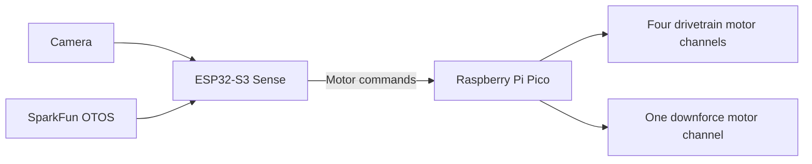

# UF IEEE Hardware Main Team 2026–27

Repository template for the University of Florida's autonomous robot for IEEE SoutheastCon 2027 Stock Car Race.

## Repository layout

| Directory | What belongs there |
| --- | --- |
| [`hub/`](hub/README.md) | ESP32-S3 Sense camera, SparkFun OTOS localization, race logic, and motor command generation. Application code goes in `hub/src/`, with headers in `hub/include/`. |
| [`pico-code/`](pico-code/README.md) | Raspberry Pi Pico motor control for four drivetrain motors and one downforce motor. Implementation goes in `pico-code/src/`, with headers in `pico-code/include/`. |
| [`pcb/`](pcb/README.md) | Schematics, board layout, wiring references, and fabrication outputs for this year's robot. |

## Proposed hardware split

The SparkFun OTOS is the localization sensor on the ESP32 side. The camera handles visual observations for the race. The Pico drives all five motor channels through their respective controllers. The drivetrain layout, board variants, and motor controller models will determine the pinout and control interfaces.

The hub is an ESP-IDF firmware project with a ROS 2 Jazzy micro-ROS dependency. The OTOS firmware currently reports pose over the local console. Connecting to a ROS 2 graph requires an ESP32 micro-ROS node, a configured transport, and a matching agent. See the [hub build and ROS 2 notes](hub/README.md).

## ESP32–Pico interface

The protocol files live under `pico-code/` to preserve last season's top-level layout. Both firmware projects will use the same [`motor_protocol.hpp`](pico-code/include/motor_protocol.hpp) and [`motor_protocol.cpp`](pico-code/src/motor_protocol.cpp).

| Direction | Data to define |
| --- | --- |
| ESP32 → Pico | Four named drivetrain commands, a separate downforce command, and enable/stop state |
| Pico → ESP32 | Output enable state and faults, plus motor feedback if the controllers provide it |

Agree on the transport and pin assignments, channel order and direction, command units and ranges, update rate, and stale-command timeout before implementing either end. Document what each board does after a reset or a link interruption.

## Competition

SoutheastCon takes place April 15–18, 2027, in Daytona Beach. For Stock Car Race, the robot runs three autonomous laps, takes a required stop in an AprilTag-assigned pit zone after lap one or two, and finishes in its assigned area. The match limit is three minutes. Green-flag starts are scored, and contact with walls or obstacles can incur penalties. See the [official student competitions page](https://ieeesoutheastcon.org/student-competitions/) for the manuals and the [IEEE at USF hardware summary](https://www.ieeeusf.com/southeastcon/) for an overview.

## Bench and track checks

- **Localization.** Move the robot a measured distance and rotate it through a known angle on the track surface. Confirm the OTOS axes, heading direction, and behavior when readings drop out.
- **Camera.** Capture examples of the starting flag, each pit assignment tag, and track obstacles under representative lighting.
- **Motor mapping.** With wheels clear of the bench, check each drivetrain output individually. Verify the downforce output independently against its own limits.
- **Board link.** Verify that output stays disabled at boot and stops when commands cease. Check recovery when either board is reset.
- **Race sequence.** Exercise the wait-for-start behavior, pit entry after lap one and after lap two, each assigned pit zone, finish after three laps, and match timeout. Record obstacles and field setup alongside each run.

## Prior UF team references

- **2025–26.** The most recent season split high-level behavior from Pico motor control. Its behavior trees and Pico command watchdog are useful references for this year's division of responsibilities. [Hub](https://github.com/IEEE-University-of-Florida/Hardware-Main-Team-25-26/tree/main/hub) · [Pico firmware](https://github.com/IEEE-University-of-Florida/Hardware-Main-Team-25-26/tree/main/pico-code)
- **2016–17 and 2017–18.** The older ROS projects separated mission planning, navigation, and controllers. The 2017–18 repo also kept low-level wheel control on an Arduino. [2016–17 repo](https://github.com/IEEE-University-of-Florida/Hardware-Main-Team-16-17) · [2017–18 repo](https://github.com/IEEE-University-of-Florida/Hardware-Main-Team-17-18)
- **2014–15.** The team documented subsystem diagnostics and used a simulated serial link to exercise both sides of its controller interface on the bench. [2014–15 README](https://github.com/IEEE-University-of-Florida/Hardware-Main-Team-14-15/blob/master/README.md)
